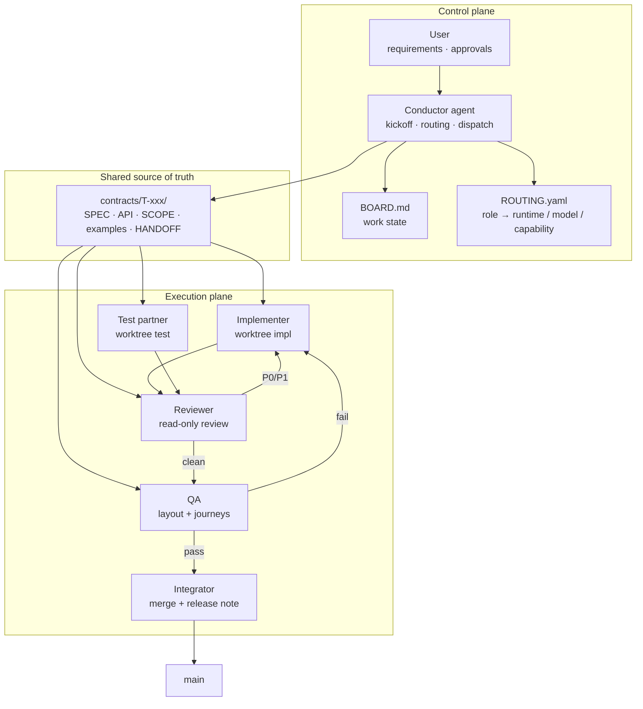

# pair-crew — multi-agent pair development

[中文](README.zh-CN.md)

**One implements. One tests. One reviews. A human decides when the contract freezes.**

**At a glance**

- **Roles, not products**: conductor, implementer, test partner, reviewer, QA, integrator.
- **Requirements gate**: no dispatch until you confirm the goal, open questions, task split, and test examples.
- **Contracts, not chat history**: SPEC, SCOPE, examples, and handoff are files in the repository.
- **One task, one worktree, one writer**: concurrent agents cannot overwrite each other.
- **Bounded review**: P0–P3, 5 rounds by default, exit after 2 clean rounds.
- **UI is two gates**: layout needs a vision model; journey needs real clicks.

pair-crew is an agent-agnostic protocol for running a small development crew: a conductor, an implementer, a test partner, a reviewer, QA, and an integrator. It is not a hosted orchestrator or a code generator. It is a set of role definitions, file contracts, quality gates, and reference adapters that keep multiple AI sessions from stepping on each other.

The conductor can be Claude Code, Codex, MiMo, or any agent that can read files, run Python, and send prompts. Qoder, Qoder CN, WorkBuddy, and ZCode are typical worker runtimes. Roles are fixed; the tools behind them are replaceable.

Built for developers and tech leads who already use more than one AI coding session — or want to — and are tired of shuttling context by hand.

## Why this exists

| The usual failure | What pair-crew changes |
|---|---|
| The AI starts coding before the requirement is clear | A kickoff draft plus a hard gate: goal, open questions, task split, test examples. Nothing is dispatched until you confirm and the contract freezes. |
| Tests are written after the code, from the code | A separate test partner writes from `examples.yaml`, not from the implementation. |
| Review is a rubber stamp, or it never ends | P0–P3 severity, a default cap of 5 rounds, and exit after 2 consecutive rounds with no new P0/P1. |
| The UI looks fine in a screenshot but the flow is broken | Two separate gates: **layout** (visual, requires a vision model) and **journey** (real browser clicks). |
| Two agents overwrite the same repository | One task, one worktree, exactly one writer per branch. |
| The workflow is tied to one vendor | Contracts, state machine, and review rules are plain files. Swap the runtime, keep the protocol. |

## How a story moves

```mermaid
flowchart TD
    A["Story request"] --> B["Kickoff draft<br/>goal · open questions · task split · test examples"]
    B --> C{"User confirms?"}
    C -->|No, revise| B
    C -->|Yes| D["Freeze contract<br/>SPEC · SCOPE · examples.yaml"]
    D --> E["Capability check<br/>routing_check.py"]
    E --> F["Isolated worktree<br/>branch impl/T-xxx"]
    F --> G["Implementer + test partner<br/>sync per example"]
    G --> H["Reviewer<br/>P0–P3 · max 5 rounds"]
    H -->|P0/P1 open| G
    H -->|2 clean rounds| I["QA<br/>examples · UI layout · journeys"]
    I -->|Fail| G
    I -->|Pass| J["SCOPE gate → integrator → main"]
```

The important part is not the diagram; it is that every arrow carries a file. The kickoff becomes `SPEC.md` and `examples.yaml`. The build produces a branch and a `HANDOFF.md`. The review produces `review/P{n}-*.md`. QA checks the same examples plus UI checklists. The integrator merges only after the SCOPE gate passes.

## Architecture

Three planes, one source of truth:



| Plane | Lives in | Job |
|---|---|---|
| **Control** | `BOARD.md`, `ROUTING.yaml`, the conductor session | Ask, freeze, route, dispatch, arbitrate, keep state |
| **Truth** | `contracts/T-xxx/` | Hold the only shared version of requirements, examples, scope, and handoff |
| **Execution** | One worktree per role and task | Implement, test, review, QA, merge without touching each other's files |

The conductor does not pass chat history around. It passes contract paths. Workers read the files from their own worktree, so a long conversation does not become the spec.

## Roles

| Role | Owns | Does not |
|---|---|---|
| **Conductor / Architect** | Kickoff, contract, task split, routing, dispatch, arbitration | Write business code |
| **Implementer** | Production code and a minimal self-test | Rewrite the contract or the partner's tests |
| **Test partner** | Unit, contract, and UI tests derived from the same examples | Change production code; raise issues to the implementer instead |
| **Reviewer** | Read-only review of the diff, P0–P3 findings | Edit the implementation branch |
| **QA** | Acceptance against examples, layout checklist, main and failure journeys, regression | Fix product code |
| **Integrator** | Merge, conflict resolution, release note, final gate | Invent features or silently expand scope |

The reviewer is deliberately not part of the writing pair. The person who wrote the code should not be the only person who signs it off.

## Pairing modes

| Mode | Shape | Use when |
|---|---|---|
| **Partner** (default) | Implementer + test partner, same examples, sync per example | Most feature stories |
| **Classic pair** | Driver implements, navigator reviews in real time | Small, interface-heavy changes |
| **Double-loop** | Implement → review → fix → re-review, capped at 3–5 rounds | Medium- or high-risk changes |
| **Swarm** | One implementer plus specialist reviewers (security, performance, testability) | Core transaction, payment, or permission paths |
| **Design pair** | Architect and test designer freeze the contract before code | New modules, cross-service work |
| **Relay** | One agent hands a half-finished branch and a handoff packet to another | Long tasks, different tool strengths |

Partner mode is the closest to a real pair. The test partner is not waiting for a finished build; both sides move example by example and challenge each other's assumptions while the code is still soft.

## Quality gates

### Test layers

| Layer | Written by | Gate |
|---|---|---|
| Unit | Test partner, supplemented by implementer | Relevant tests green |
| Contract / acceptance | Test partner, from `examples.yaml` | Every example passes |
| Integration / API | Test partner and QA | API contract stays stable |
| **UI layout** | Test partner, run by a vision-capable model | No overflow, overlap, broken breakpoints, unreadable long text, or missing empty/error/loading states |
| **UI journey** | Test partner, usually Playwright | Main path plus at least one failure path actually click through |
| SCOPE | Script and reviewer | Diff stays out of forbidden areas |
| Review | Reviewer | No open P0/P1 |

Layout and journey are separate on purpose. A page can look perfect in a screenshot and still fail when a user clicks the primary button. A text-only model may write journey scripts and DOM assertions; it cannot sign off a visual layout.

### Review severity and convergence

| Level | Meaning | Handling |
|---|---|---|
| **P0** | Correctness, security, or data loss | Must fix; blocks merge |
| **P1** | Contract violation or clear defect | Must fix; can be batched in one round |
| **P2** | Quality or maintainability | Fix or record as debt |
| **P3** | Style or naming | Optional |

Exit rule: **2 consecutive rounds with no new P0/P1**, with a default cap of **5 rounds**. Anything beyond that goes to a human. This is not bureaucracy; unbounded review loops are how multi-agent work turns into a token furnace.

### Capability routing

`ROUTING.yaml` binds a role to a runtime, a model group, and required capabilities:

```yaml
roles:
  ui_layout_tester:
    runtime: local-session
    model: vision
    requires: [vision, image_read]

  implementer:
    runtime: external-ide
    tool: qoder
    model: code
    reasoning: high
```

Before work starts, `routing_check.py` verifies that the model behind a role can actually do the job. A role that requires vision cannot be routed to a text-only model. An external IDE that is not reachable is an error, not a surprise at dispatch time. Keep implementation and review on different models when you can; same-model review inherits the same blind spots.

### Human gates

The conductor must stop and ask before:

1. Freezing a story that has open questions or unclear scope.
2. Every external dispatch: target tool, project name, absolute path, new vs. resume, and full-access permission.
3. A scope change, a P0 disagreement, or a review that exceeds the round cap.
4. Merging to `main` or doing anything publicly visible.
5. A dispatch failure that requires a human to click, authorize, or pick a workspace.

These are not suggestions. A conductor that silently fills in a missing requirement is not following this protocol.

## Repository layout

```text
skills/pair-crew/
  SKILL.md                  # conductor protocol and trigger words
  templates/                # kickoff, handoff, routing, dispatch checklist, contract templates
  scripts/
    routing_check.py        # capability and IDE gate
    ide_guard.py            # verify a project is bound to an absolute path (run before dispatch)
    send_qoder.py           # reference CDP adapter for Qoder
    send_zcode.py           # reference CDP adapter for ZCode
    send_followup.py        # follow-up into a running session; verifies session, clicks queue button
    collect_review.py       # read verdicts from the IDE DB; --wait blocks until one appears
docs/
  multi-agent-pair-plan.md  # design rationale, role design, test layers, rollout plan
contracts/
  T-smoke-001..004/         # read-only channel smoke tests
.agents/
  ROUTING.yaml              # local example binding
  BOARD.md                  # work board
```

`worktrees/` is created at runtime and is gitignored. The board and handoff are file conventions, not a service; there is no daemon or database to run.

## Quick start(Just send the repository address to the agent so they can install it and tell you how to use it, then ignore the following content (●'◡'●).

1. **Put the skill where your conductor can read it.** Use the repository as-is, copy `skills/pair-crew/` into your project's agent skills directory, or reference `SKILL.md` from `AGENTS.md` / `CLAUDE.md`.

2. **Copy the templates you need.**

   ```bash
   mkdir -p .agents contracts worktrees
   cp skills/pair-crew/templates/ROUTING.yaml .agents/ROUTING.yaml
   cp skills/pair-crew/templates/STORY_KICKOFF.md .agents/
   cp skills/pair-crew/templates/HANDOFF.md .agents/
   cp skills/pair-crew/templates/DISPATCH_CHECKLIST.md .agents/
   ```

   For each task, create `contracts/T-xxx/` and copy the files from `skills/pair-crew/templates/contracts/`. If you already have `.agents/ROUTING.yaml`, edit it instead of overwriting it. Create `.agents/BOARD.md` with the status legend from `SKILL.md`; this repository's `.agents/BOARD.md` is a filled example.

3. **Fill `ROUTING.yaml`.** Map `vision`, `code`, and `critic` to models you actually have. Set the implementer tool and the reviewer model. If implementation and review use the same model, you are skipping an important check.

4. **Run the gate.**

   ```bash
   python skills/pair-crew/scripts/routing_check.py --routing .agents/ROUTING.yaml
   ```

   Exit code `0` means no blocking issue. Warnings are visible but do not block. Python 3 is enough; PyYAML is recommended, with a minimal fallback parser for simple files.

5. **Start a story.** Tell the conductor: `Use pair-crew for this story: ...`. It should produce a kickoff draft and wait for your confirmation. If it starts editing code before that, stop it.

## Connecting agents

| What you have | How it plugs in |
|---|---|
| A conductor that can read files and run Python | Use `SKILL.md` directly |
| Local sessions or subagents | Conductor spawns a role in an isolated worktree with a prompt file and contract paths |
| External GUI IDE (Qoder, ZCode, WorkBuddy, etc.) | A CDP adapter sends the prompt file and reads the result back; verify workspace, absolute path, and access first |
| CLI agent (Claude Code, Codex, etc.) | Run it headless inside the worktree with the contract package |
| A human | Confirms the kickoff, approves dispatches, arbitrates P0s, merges |

`send_qoder.py` and `send_zcode.py` are reference adapters, not the protocol. They drive the IDE's UI over CDP and load a local `cdp.py` helper from the `external-review` skill (or a vendored copy). GUI selectors are brittle; when an IDE changes its UI, fix the adapter or dispatch manually. The contract flow does not depend on the adapter.

### Two CDP pitfalls that silently corrupt a dispatch

Both were hit in production use and are now guarded in code — do not remove the guards.

**1. Project binding is not a project name.**
The old adapters only checked "does the sidebar text contain this project name", then typed
into the **currently open** session. When the target directory had never been opened in that
IDE, the task was silently delivered to an unrelated session — the ZCode session it landed in
had `directory = E:\project_self\coding_skill\.mimocode`, while the task was about a completely
different repository on `D:`. The adapter still printed `SENT`.

`ide_guard.require()` now resolves binding by absolute path, reading the IDE's own database:
`~/.zcode/v2/tasks-index.sqlite` (`projects` + `project_roots`, plus `v2/setting.json`
`recentProjects`) for ZCode, and `main.sqlite` (`workspaces.root_paths_json` +
`chat_sessions.workspace_id`) for Qoder. Reading ZCode's session table alone is not enough —
a project that exists but has never had a session opened in it is invisible there.
Verify with `ide_guard.py --ide zcode --list` / `--sessions`. Name matching is unusable:
ZCode derives `project_id` from the path and drops non-ASCII (`D:\projects\海豚屋` and
`D:\projects\做课` both collapse to `proj_d-projects`), and Qoder can hold duplicate
workspace rows with the same name.

**2. The queue button is not called "立即".**
When an agent is mid-generation, `insertText + Enter` does not execute the message — it joins
a queue, and a button appears on the bubble that must be clicked to interrupt. ZCode calls it
`立即`; **Qoder CN calls it `插话`**. An adapter that only matches `立即` never clicks anything
on Qoder, so the message sits at the tail of the queue forever and looks unread.
`send_followup.py` matches `立即 / 插话 / 立即发送 / 立即执行 / 打断 / 现在就发`, and clicks the
lowest one so historical leftover buttons are not re-triggered.

`send_followup.py` also verifies which session it is talking to: pass `--switch-to <title>`
or `--expect <title substring>`, and it compares the `chat id` before and after sending —
if the id changed, it fails loudly instead of reporting success.


**3. Reading a verdict: never `immutable=1`, never poll only once.**
Two traps, both of which produced confidently wrong reports:

- `sqlite3.connect("file:...?immutable=1")` is a promise that the file will not change, so
  SQLite skips the WAL and keeps returning the snapshot taken at open time. IDE writes land in
  `-wal`, so new messages were invisible: the count looked frozen at 14 while the table really
  held 44, and an answer that had already finished looked like "it never replied". Read with
  `mode=ro` plus `PRAGMA query_only=1`.
- Qoder updates **the same assistant message in place**, so message count does not change when
  a new verdict arrives. Judge by the last assistant message's `updated_at` and body, not by
  `COUNT(*)`. And since dispatch is asynchronous while an agent turn is not, "dispatched" is not
  "reviewed": `collect_review.py --wait --session <id>` blocks until a verdict word appears
  (exit 0 verdict, exit 2 timeout — a timeout is not a failure, the worker may still be running).

The channel smoke tests in `contracts/T-smoke-*` cover Qoder CN, Qoder international, ZCode, and WorkBuddy. They verify that a worker can bind to the right workspace, read the contract, and report back; they are not a guarantee that every future IDE version will behave.

## What this is, and what it is not

| It is | It is not |
|---|---|
| A protocol plus file contracts plus reference adapters | A hosted orchestrator or SaaS |
| A way to keep multiple agent sessions from colliding | A guarantee that every model follows instructions |
| Human-in-the-loop by design | An autonomous merge bot |
| Tool-agnostic | A wrapper around one IDE's private API |

## Status

The protocol, templates, and `routing_check` are usable now. The reference adapters have been smoke-tested against a small set of GUI IDEs; they require maintenance as those IDEs change. The board, handoff, and worktree layout are conventions you adopt, not services this repository runs. There is no telemetry, no daemon, and no vendor account required.

## Design principles

1. Accurate requirements before speed.
2. Contracts before code.
3. Roles decoupled from tools.
4. UI tests are first-class: layout needs eyes, journeys need clicks.
5. One task, one worktree, one writer.
6. Bounded review, or it becomes the bottleneck.
7. Human confirmation before every external dispatch and every high-risk action.

## License

MIT
