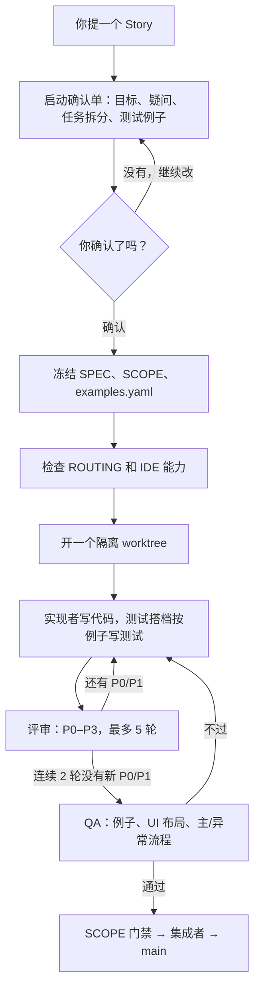
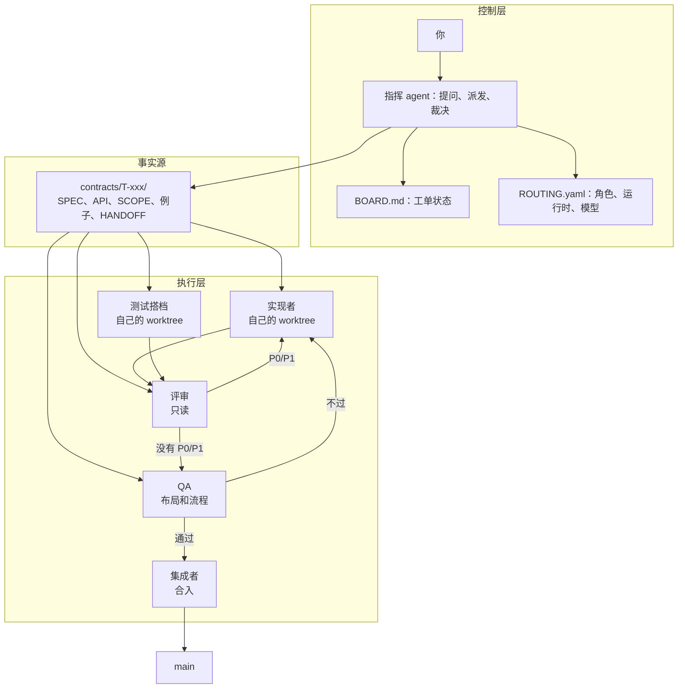

# pair-crew — 多 Agent 结对开发

[English](README.md)

一个人写实现，一个人写测试，另一个人负责挑问题；需求没确认之前，先别开工。

pair-crew 是一套给多个 AI agent 用的协作规矩。它不绑定某个产品，也不要求你换工具：Claude Code、Codex、MiMo 可以当指挥，Qoder、Qoder CN、WorkBuddy、ZCode 可以当工位。角色是固定的，角色背后用什么工具可以换。

它想解决的问题很具体：几个 AI 会话同时做一个仓库，别互相踩；别把聊天记录当需求；别让实现和测试各写各的；别让评审一直改下去；也别让 UI 只停留在“截图看起来还行”。

## 适合谁

如果你已经在用两个以上的 AI 会话写代码，或者正准备这么做，pair-crew 会比较有用。尤其是那种“实现在一个窗口、测试在另一个窗口、评审再开一个”的工作方式，靠人来回复制上下文，很容易乱。

如果你只是偶尔让 AI 补个函数，这套流程可能有点重。它可以拆着用，但没必要为了一个几十行的改动开一整套契约。

## 一个 Story 怎么走



说人话就是：

1. 你提一个需求，指挥先不写代码，先把它整理成一份启动确认单：要做什么、不做什么、还有哪些地方不明白、任务怎么拆、测试例子有哪些。
2. 你看一遍，把不对的地方改掉。确认之后，这些内容写进 `SPEC.md`、`SCOPE.md` 和 `examples.yaml`，然后冻结。
3. 实现者和测试搭档各开一个 worktree，按同一套例子往前做。实现写生产代码，测试搭档写单测、契约测和 UI 测，不照着实现反推。
4. 做得差不多了就提评审。评审只读 diff，按 P0–P3 提问题。P0/P1 必须修，P2/P3 可以记债。
5. 连续两轮没有新的 P0/P1，或者到了 5 轮上限，就进 QA。QA 按例子验收，再看 UI 布局和主/异常流程。
6. 都过了，集成者再过一遍 SCOPE 门禁，合进 `main`。

这套流程里，每个环节都要留下文件。启动会变成 `SPEC.md` 和 `examples.yaml`，实现会留下分支和 `HANDOFF.md`，评审会留下 `review/P{n}-*.md`。这样换一个 agent 接手，或者过几天再回来看，不用靠翻聊天记录猜。

## 三层，一个事实源



| 层 | 放在哪 | 干什么 |
|---|---|---|
| 控制层 | `BOARD.md`、`ROUTING.yaml`、指挥会话 | 提问、冻结、派发、裁决，维护工单状态 |
| 事实源 | `contracts/T-xxx/` | 保存需求、例子、范围和交接的唯一共享版本 |
| 执行层 | 每个角色自己的 worktree | 实现、测试、评审、QA、合入，互相不碰文件 |

指挥不把聊天记录传来传去，只传契约路径。工位在自己的 worktree 里读文件，长对话不会变成隐式需求。

## 谁干什么

| 角色 | 负责 | 不做什么 |
|---|---|---|
| 指挥 / 架构 | 启动单、契约、任务拆分、路由、派发、裁决 | 不写业务代码 |
| 实现者 | 生产代码和最小自测 | 不随手改契约，不替测试搭档写完整测试 |
| 测试搭档 | 按同一套例子写单测、契约测、UI 测 | 不改生产代码；发现问题提给实现者 |
| 评审 | 只读 diff，出 P0–P3 意见 | 不改实现分支 |
| QA | 按例子验收，检查布局清单和主/异常流程，做回归 | 不修产品代码 |
| 集成者 | 合入、解冲突、写发布说明、过最后一道门禁 | 不发明功能，不静默扩大范围 |

评审故意不参与并写。写代码的人不能是唯一签字的人。

## 几种结对方式

默认是“搭档开发”：一个写实现，一个写测试，按例子同步。除此之外还有几种模式，按任务复杂度选。

| 模式 | 怎么搭 | 什么时候用 |
|---|---|---|
| 搭档开发（默认） | 实现 + 测试，同一套例子，按例子同步 | 大多数功能 Story |
| 经典结对 | Driver 写，Navigator 实时跟审 | 小改动、接口复杂 |
| 双环评审 | 实现 → 评审 → 修 → 复审，3–5 轮封顶 | 中高风险改动 |
| 蜂群 | 1 个实现 + N 个专项评审，比如安全、性能、可测性 | 核心交易、支付、权限 |
| 设计结对 | 架构和测试设计先把契约冻结 | 新模块、跨服务 |
| 接力 | A 交半成品和交接包，B 接手 | 长任务，或者不同工具各有所长 |

默认的搭档开发最接近真人 pair。测试搭档不是等实现写完再补测试，而是按例子同步推进，在代码还软的时候就把假设顶回去。

## 质量门禁

### 测试分几层

| 层 | 谁写 | 过门条件 |
|---|---|---|
| 单测 | 测试搭档为主，实现者补 | 相关测试绿 |
| 契约 / 验收 | 测试搭档，按 `examples.yaml` | 每条例子都过 |
| 集成 / 接口 | 测试搭档 + QA | API 契约不破 |
| UI 布局 | 测试搭档写，能看图的模型跑 | 不溢出、不遮挡、断点正常、长文案不截断、空/错/加载态齐全 |
| UI 流程 | 测试搭档，通常用 Playwright | 主路径和至少一条失败路径真的点通 |
| SCOPE | 脚本 + 评审 | diff 不越禁区 |
| 评审 | 评审 | 没有未处理的 P0/P1 |

布局和流程故意分开。截图完美，不代表用户点得通。纯文本模型可以写流程脚本、跑 DOM 断言，但不能给布局签字。

### 评审怎么收敛

| 级别 | 含义 | 处理 |
|---|---|---|
| P0 | 正确性、安全、数据损坏 | 必须修，阻断合入 |
| P1 | 契约违反、明显缺陷 | 必须修，可以一轮集中处理 |
| P2 | 质量、可维护性 | 修掉或记债 |
| P3 | 风格、命名 | 可选 |

退出规则是：连续 2 轮没有新增 P0/P1，或者到了 5 轮上限。超过就升级到人。评审不封顶，最后往往会变成没完没了的 token 消耗。

### 能力路由

`ROUTING.yaml` 把角色绑到运行时、模型组和能力要求：

```yaml
roles:
  ui_layout_tester:
    runtime: local-session
    model: vision
    requires: [vision, image_read]

  implementer:
    runtime: external-ide
    tool: qoder
    model: code
    reasoning: high
```

开工前 `routing_check.py` 会验证角色背后的模型真的能干这个活。要求 vision 的岗位不能排给纯文本模型；外部 IDE 连不上就直接报错，别等到派发时才发现。实现和评审尽量用不同模型，同模型评审会继承同一套盲区。

### 哪些地方必须停下来问

指挥遇到下面这些，要先停下来问人：

1. Story 还有未决问题、范围不清，不能冻结。
2. 每次外部派发：目标工具、项目名、绝对路径、新建还是续写、是否完全访问。
3. 范围变更、P0 分歧、评审超过轮次上限。
4. 合入 `main`，或者任何对外可见的高风险动作。
5. 派发失败，需要人点授权、选工作区、处理占用。

这些地方不要替用户猜。猜需求、猜权限，后面大概率要返工。

## 仓库结构

```text
skills/pair-crew/
  SKILL.md                  # 指挥协议和触发词
  templates/                # 启动单、交接包、路由、派发清单、契约模板
  scripts/
    routing_check.py        # 能力和 IDE 门禁
    ide_guard.py            # 按绝对路径核对项目绑定（派发前必跑）
    send_qoder.py           # Qoder 参考适配器（CDP）
    send_zcode.py           # ZCode 参考适配器（CDP）
    send_followup.py        # 向运行中的会话续写；校验会话归属并点掉排队按钮
docs/
  multi-agent-pair-plan.md  # 设计思路、角色设计、测试分层、落地路线
contracts/
  T-smoke-001..004/         # 只读通道冒烟
.agents/
  ROUTING.yaml              # 本地示例绑定
  BOARD.md                  # 工单板
```

`worktrees/` 运行时创建，已经被 gitignore。工单板和交接包是文件约定，不是服务，不需要起守护进程或数据库。

## 怎么开始（直接把仓库地址发给 agent，让他安装并告诉你如何使用，然后忽略下面内容 (●'◡'●)）

1. 把 skill 放到指挥能读到的地方。直接用本仓库，或者把 `skills/pair-crew/` 拷进项目的 agent skills 目录，也可以在 `AGENTS.md` / `CLAUDE.md` 里引用 `SKILL.md`。

2. 拷模板：

   ```bash
   mkdir -p .agents contracts worktrees
   cp skills/pair-crew/templates/ROUTING.yaml .agents/ROUTING.yaml
   cp skills/pair-crew/templates/STORY_KICKOFF.md .agents/
   cp skills/pair-crew/templates/HANDOFF.md .agents/
   cp skills/pair-crew/templates/DISPATCH_CHECKLIST.md .agents/
   ```

   每个任务建 `contracts/T-xxx/`，从 `skills/pair-crew/templates/contracts/` 拷契约模板。如果已经有 `.agents/ROUTING.yaml`，直接改，别覆盖。按 `SKILL.md` 的状态图例建 `.agents/BOARD.md`；本仓库的 `.agents/BOARD.md` 是一个填好的示例。

3. 填 `ROUTING.yaml`。把 `vision`、`code`、`critic` 换成你实际有的模型，设置实现工具和评审模型。实现和评审用同一个模型，等于少了一道检查。

4. 跑门禁：

   ```bash
   python skills/pair-crew/scripts/routing_check.py --routing .agents/ROUTING.yaml
   ```

   退出码 `0` 表示没有阻断项。警告会显示，但不拦。Python 3 就够；推荐装 PyYAML，简单文件有内置的极简解析兜底。

5. 对指挥说：`用 pair-crew 做这个 Story：……`。它应该先出启动确认单，等你确认。如果它没确认就开始改代码，叫停。

## 怎么接不同 agent

| 你手里有什么 | 怎么接 |
|---|---|
| 能读文件、跑 Python 的指挥 | 直接用 `SKILL.md` |
| 本地会话或子代理 | 指挥在隔离 worktree 里起角色，给 prompt 文件和契约路径 |
| 外部 GUI IDE（Qoder、ZCode、WorkBuddy 等） | 用 CDP 适配器发 prompt 文件并读回结果；先核对工作区、绝对路径和访问权限 |
| CLI agent（Claude Code、Codex 等） | 在 worktree 里 headless 跑，喂契约包 |
| 人 | 确认启动单、批准派发、裁决 P0、合入 |

`send_qoder.py` 和 `send_zcode.py` 是参考适配器，不是协议本身。它们通过 CDP 驱动 IDE 界面，并从 `external-review` skill（或 vendored 副本）加载本地 `cdp.py`。GUI 选择器很脆，IDE 一改版就要修，或者退回人工派发。契约流程本身不依赖适配器。

### 两个会静默搞砸派发的 CDP 坑

两个都是真实踩过的，现在已经在代码里上了门禁 —— 不要把它们删掉。

**1. 项目归属不能按名字认。**
旧适配器只判断「侧栏文本里含不含这个项目名」，然后往**当前打开的会话**里打字。当目标目录
在那个 IDE 里从来没打开过时，任务会被静默送进一个完全无关的会话 —— 实测落到的那条 ZCode
会话 `directory = E:\project_self\coding_skill\.mimocode`，而任务写的是 D 盘另一个仓库。
适配器照样打印 `SENT`。

现在 `ide_guard.require()` 按**绝对路径**核对，直接读 IDE 自己的库：
ZCode 读 `~/.zcode/cli/db/db.sqlite` 的 `session.project_id` + `session.directory`，
Qoder 读 `main.sqlite` 的 `workspaces.root_paths_json` + `chat_sessions.workspace_id`。
排查用 `ide_guard.py --ide zcode --list` / `--sessions`。

名字根本不可用：ZCode 的 `project_id` 由路径派生且会丢掉非 ASCII
（`D:\projects\海豚屋` 和 `D:\projects\做课` 都塌成 `proj_d-projects`），
Qoder 则可能出现同名工作区重复登记。

**2. 插话按钮不叫「立即」。**
agent 正在生成时，`insertText + Enter` 不会立刻执行，而是进排队队列，气泡上会多出一个
按钮，必须点它才会插队。ZCode 叫 `立即`，**Qoder CN 叫 `插话`**。
只匹配 `立即` 的适配器在 Qoder 上一个按钮也点不到，消息永远排在队尾，看起来像「没发出去」。
`send_followup.py` 匹配 `立即 / 插话 / 立即发送 / 立即执行 / 打断 / 现在就发`，
并且取**最靠下**那个，避免把历史残留按钮重新触发。

`send_followup.py` 还会核对这次到底在跟哪个会话说话：传 `--switch-to <标题>` 或
`--expect <标题关键词>`，发送前后比对 `chat id`，变了就直接报错，而不是报成功。


`contracts/T-smoke-*` 里的通道冒烟覆盖 Qoder CN、Qoder 国际版、ZCode 和 WorkBuddy。它们验证的是工位能绑定到正确工作区、读契约、回报结果，不保证未来每个 IDE 版本都行为一致。

## 它不是什么

| 它是 | 它不是 |
|---|---|
| 一套协议、几份文件契约、几个参考适配器 | 一个托管的编排服务或 SaaS |
| 让多个 agent 会话不互相踩的方法 | 保证每个模型都听话 |
| 需要人参与的工作流 | 自动合入机器人 |
| 与工具无关 | 某一家 IDE 私有 API 的封装 |

## 现在的状态

协议、模板和 `routing_check` 现在就能用。参考适配器在一小组 GUI IDE 上做过冒烟；这些 IDE 改版就要维护。工单板、交接包和 worktree 布局是你采用的约定，不是本仓库运行的服务。没有遥测，没有守护进程，也不需要厂商账号。

## 这套东西的取舍

需求没说清，就别写代码。契约落到文件，才算数。实现和评审尽量换模型，别自己审自己。UI 不能只看截图，要真的点一遍。一个任务一个 worktree，同一时间只有一个写者。评审要有轮次上限。每次派发外部工具、每次合入 `main`，都先问人。

## License

MIT
