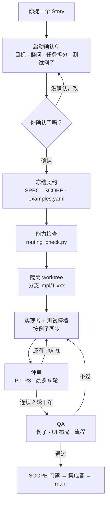
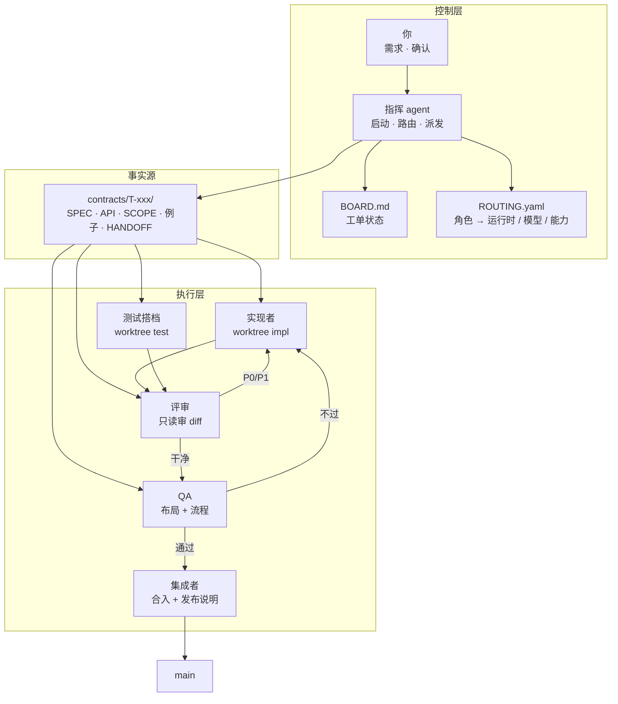

# pair-crew — 多 Agent 结对开发

[English](README.md)

**一人写实现，一人写测试，有人评审；需求确认后契约才冻结。**

**一眼看懂**

- **角色，不是产品**：指挥、实现者、测试搭档、评审、QA、集成者。
- **需求门禁**：目标、疑问、任务拆分、测试例子确认前，不派发。
- **契约，不是聊天记录**：SPEC、SCOPE、例子表、交接包都是仓库里的文件。
- **一任务一 worktree、单写者**：并发 agent 不会互相覆盖。
- **评审可收敛**：P0–P3，默认最多 5 轮，连续 2 轮无新增 P0/P1 即退出。
- **UI 两道门**：布局要能看图的模型，流程要真点浏览器。

pair-crew 是一套与 agent 无关的协作协议，用来组织一个小型开发班组：指挥、实现者、测试搭档、评审、QA、集成者。它不是托管的编排服务，也不是代码生成器。它是一组角色定义、文件契约、质量门禁和参考适配器，让多个 AI 会话不互相踩踏。

指挥可以是 Claude Code、Codex、MiMo，或任何能读文件、跑 Python、发 prompt 的 agent。Qoder、Qoder CN、WorkBuddy、ZCode 是常见的工位运行时。角色固定，角色背后的工具可以换。

适合已经在用、或准备用多个 AI 编码会话的开发者和技术负责人——尤其是受够了手工搬运上下文的人。

## 解决什么问题

| 常见的翻车方式 | pair-crew 怎么改 |
|---|---|
| AI 在需求没对齐前就开写 | 先出启动确认单：目标、疑问、任务拆分、测试例子；你确认并冻结契约后才派发 |
| 测试是照着实现补的 | 测试搭档按 `examples.yaml` 写，不照实现反推 |
| 评审要么走过场，要么停不下来 | P0–P3 分级，默认最多 5 轮，连续 2 轮无新增 P0/P1 即退出 |
| 截图看着挺好，一用就断 | 布局（要视觉模型）和流程（真点浏览器）分开验收 |
| 两个 agent 抢同一个仓库 | 一任务一 worktree，一条分支只有一个写者 |
| 流程绑死在某一家工具 | 契约、状态机、评审规则都是纯文件；换运行时，不换协议 |

## 一个 Story 怎么走



关键不是这张图，而是每个箭头都带一个文件。启动会变成 `SPEC.md` 和 `examples.yaml`；实现产出分支和 `HANDOFF.md`；评审产出 `review/P{n}-*.md`；QA 对照同一套例子和 UI 清单；集成者过了 SCOPE 门禁才合入。

## 架构

三层，一个事实源：



| 层 | 落在哪 | 干什么 |
|---|---|---|
| **控制层** | `BOARD.md`、`ROUTING.yaml`、指挥会话 | 提问、冻结、路由、派发、裁决、维护状态 |
| **事实源** | `contracts/T-xxx/` | 保存需求、例子、范围、交接的唯一共享版本 |
| **执行层** | 每个角色/任务一个 worktree | 实现、测试、评审、QA、合入互不踩文件 |

指挥不传聊天记录，只传契约路径。工位在自己的 worktree 里读文件，长对话不会变成隐式需求。

## 角色

| 角色 | 负责 | 不做什么 |
|---|---|---|
| **指挥 / 架构** | 启动单、契约、任务拆分、路由、派发、裁决 | 不写业务代码 |
| **实现者** | 生产代码和最小自测 | 不改契约，不替测试搭档写完整测试 |
| **测试搭档** | 按同一套例子写单测、契约测、UI 测 | 不改生产代码；发现问题提给实现者 |
| **评审** | 只读审 diff，出 P0–P3 | 不改实现分支 |
| **QA** | 按例子验收、布局清单、主/异常流程、回归 | 不修产品码 |
| **集成者** | 合入、解冲突、发布说明、最后门禁 | 不发明功能，不静默扩范围 |

评审故意不参与并写。写代码的人不能是唯一签字的人。

## 结对模式

| 模式 | 形态 | 什么时候用 |
|---|---|---|
| **搭档开发**（默认） | 实现 + 测试，同一套例子，按例子同步 | 大多数功能 Story |
| **经典结对** | Driver 写，Navigator 实时跟审 | 小改动、接口复杂 |
| **双环评审** | 实现 → 评审 → 修 → 复审，3–5 轮封顶 | 中高风险改动 |
| **蜂群** | 1 个实现 + N 个专项评审（安全/性能/可测） | 核心交易、支付、权限 |
| **设计结对** | 架构和测试设计先把契约冻结 | 新模块、跨服务 |
| **接力** | A 交半成品 + 交接包，B 接手 | 长任务、不同工具各有所长 |

默认的搭档开发最接近真人 pair。测试搭档不是等实现写完再补测试，而是按例子同步推进，在代码还软的时候就把假设顶回去。

## 质量门禁

### 测试分层

| 层 | 谁写 | 过门条件 |
|---|---|---|
| 单测 | 测试搭档为主，实现者补 | 相关测试绿 |
| 契约 / 验收 | 测试搭档，按 `examples.yaml` | 每条例子都过 |
| 集成 / 接口 | 测试搭档 + QA | API 契约不破 |
| **UI 布局** | 测试搭档写，能看图的模型跑 | 不溢出、不遮挡、断点正常、长文案不截断、空/错/加载态齐全 |
| **UI 流程** | 测试搭档，通常用 Playwright | 主路径 + 至少一条失败路径真的点通 |
| SCOPE | 脚本 + 评审 | diff 不越禁区 |
| 评审 | 评审 | 没有未处理的 P0/P1 |

布局和流程故意分开。截图完美，不代表用户点得通。纯文本模型可以写流程脚本、跑 DOM 断言，但不能给布局签字。

### 评审分级与收敛

| 级别 | 含义 | 处理 |
|---|---|---|
| **P0** | 正确性、安全、数据损坏 | 必须修，阻断合入 |
| **P1** | 契约违反、明显缺陷 | 必须修，可一轮集中处理 |
| **P2** | 质量、可维护性 | 修掉或记债 |
| **P3** | 风格、命名 | 可选 |

退出规则：**连续 2 轮没有新增 P0/P1**，默认上限 **5 轮**。超过就升级人工。这不是流程洁癖；评审不封顶，多 agent 协作就会变成烧 token 的无底洞。

### 能力路由

`ROUTING.yaml` 把角色绑到运行时、模型组和能力要求：

```yaml
roles:
  ui_layout_tester:
    runtime: local-session
    model: vision
    requires: [vision, image_read]

  implementer:
    runtime: external-ide
    tool: qoder
    model: code
    reasoning: high
```

开工前 `routing_check.py` 会验证角色背后的模型真的能干这个活。要求 vision 的岗位不能排给纯文本模型；外部 IDE 连不上是错误，不是派发时才发现的惊喜。实现和评审尽量用不同模型，同模型评审会继承同一套盲区。

### 人工门禁

指挥遇到下面这些必须先停下来问：

1. Story 还有未决问题、范围不清，不能冻结。
2. 每次外部派发：目标工具、项目名、绝对路径、新建还是续写、是否完全访问。
3. 范围变更、P0 分歧、评审超过轮次上限。
4. 合入 `main`，或任何对外可见的高风险动作。
5. 派发失败，需要人点授权、选工作区、处理占用。

这些不是建议。一个默默替用户补齐需求的指挥，不算在按这套协议工作。

## 仓库结构

```text
skills/pair-crew/
  SKILL.md                  # 指挥协议与触发词
  templates/                # 启动单、交接包、路由、派发清单、契约模板
  scripts/
    routing_check.py        # 能力与 IDE 门禁
    send_qoder.py           # Qoder 参考适配器（CDP）
    send_zcode.py           # ZCode 参考适配器（CDP）
docs/
  multi-agent-pair-plan.md  # 设计思路、角色设计、测试分层、落地路线
contracts/
  T-smoke-001..004/         # 只读通道冒烟
.agents/
  ROUTING.yaml              # 本地示例绑定
  BOARD.md                  # 工单板
```

`worktrees/` 运行时创建，已被 gitignore。工单板和交接包是文件约定，不是服务；不需要起守护进程或数据库。

## 快速开始

1. **把 skill 放到指挥能读到的地方。** 直接使用本仓库，或把 `skills/pair-crew/` 拷进项目的 agent skills 目录，或在 `AGENTS.md` / `CLAUDE.md` 里引用 `SKILL.md`。

2. **拷模板。**

   ```bash
   mkdir -p .agents contracts worktrees
   cp skills/pair-crew/templates/ROUTING.yaml .agents/ROUTING.yaml
   cp skills/pair-crew/templates/STORY_KICKOFF.md .agents/
   cp skills/pair-crew/templates/HANDOFF.md .agents/
   cp skills/pair-crew/templates/DISPATCH_CHECKLIST.md .agents/
   ```

   每个任务建 `contracts/T-xxx/`，从 `skills/pair-crew/templates/contracts/` 拷契约模板。如果已有 `.agents/ROUTING.yaml`，直接改，不要覆盖。按 `SKILL.md` 的状态图例建 `.agents/BOARD.md`；本仓库的 `.agents/BOARD.md` 是一个填好的示例。

3. **填 `ROUTING.yaml`。** 把 `vision`、`code`、`critic` 换成你实际有的模型；设置实现工具和评审模型。实现和评审用同一个模型，等于少了一道检查。

4. **跑门禁。**

   ```bash
   python skills/pair-crew/scripts/routing_check.py --routing .agents/ROUTING.yaml
   ```

   退出码 `0` 表示没有阻断项。警告会显示，但不拦。Python 3 即可；推荐装 PyYAML，简单文件有内置的极简解析兜底。

5. **提一个 Story。** 对指挥说：`用 pair-crew 做这个 Story：……`。它应该先出启动确认单并等你确认。如果它没确认就开始改代码，叫停。

## 怎么接 agent

| 你手里有什么 | 怎么接 |
|---|---|
| 能读文件、跑 Python 的指挥 | 直接用 `SKILL.md` |
| 本地会话 / 子代理 | 指挥在隔离 worktree 里起角色，给 prompt 文件和契约路径 |
| 外部 GUI IDE（Qoder、ZCode、WorkBuddy 等） | 用 CDP 适配器发 prompt 文件并读回结果；先核对工作区、绝对路径、访问权限 |
| CLI agent（Claude Code、Codex 等） | 在 worktree 里 headless 跑，喂契约包 |
| 人 | 确认启动单、批准派发、裁决 P0、合入 |

`send_qoder.py` 和 `send_zcode.py` 是参考适配器，不是协议本身。它们通过 CDP 驱动 IDE 界面，并从 `external-review` skill（或 vendored 副本）加载本地 `cdp.py`。GUI 选择器很脆；IDE 一改版，就修适配器或改人工派发。契约流程不依赖适配器。

`contracts/T-smoke-*` 里的通道冒烟覆盖 Qoder CN、Qoder 国际版、ZCode 和 WorkBuddy。它们验证的是工位能绑定到正确工作区、读契约、回报结果；不保证未来每个 IDE 版本都行为一致。

## 是什么，不是什么

| 是 | 不是 |
|---|---|
| 协议 + 文件契约 + 参考适配器 | 托管的编排服务或 SaaS |
| 让多个 agent 会话不互相踩的方法 | 保证每个模型都听话 |
| 设计上必须有人参与 | 自动合入机器人 |
| 与工具无关 | 某一家 IDE 私有 API 的封装 |

## 状态

协议、模板和 `routing_check` 现在就能用。参考适配器在一小组 GUI IDE 上做过冒烟；这些 IDE 改版就要维护。工单板、交接包、worktree 布局是你采用的约定，不是本仓库运行的服务。没有遥测、没有守护进程、不需要厂商账号。

## 设计原则

1. 需求准确优先于开工速度。
2. 契约先于代码。
3. 角色与工具解耦。
4. UI 测试是一等公民：布局要眼睛，流程要点击。
5. 一任务一 worktree，单写者。
6. 评审必须封顶，否则它自己会变成瓶颈。
7. 每次外部派发和每个高风险动作，先让人确认。

## License

MIT
