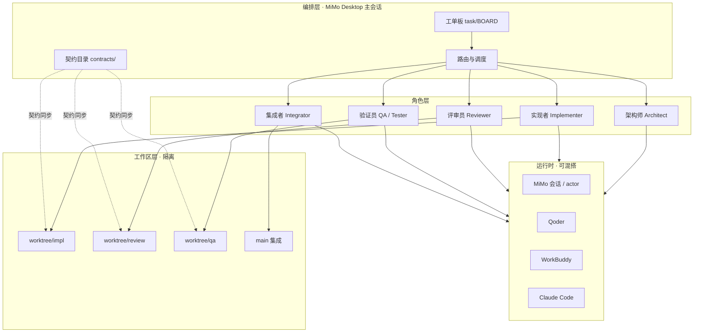
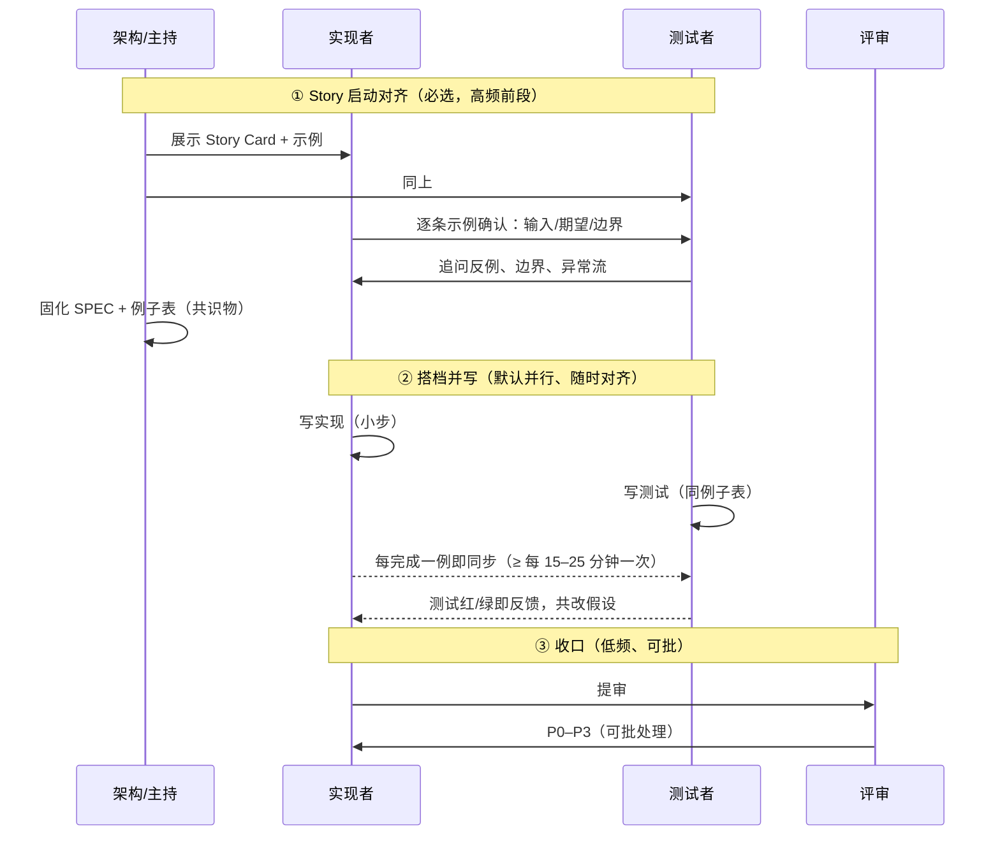
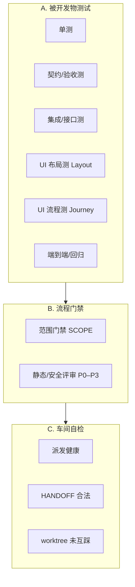
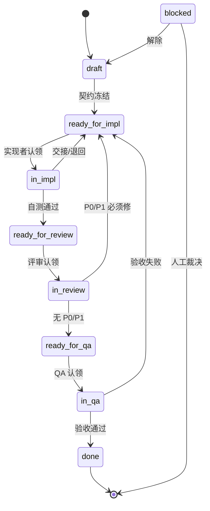
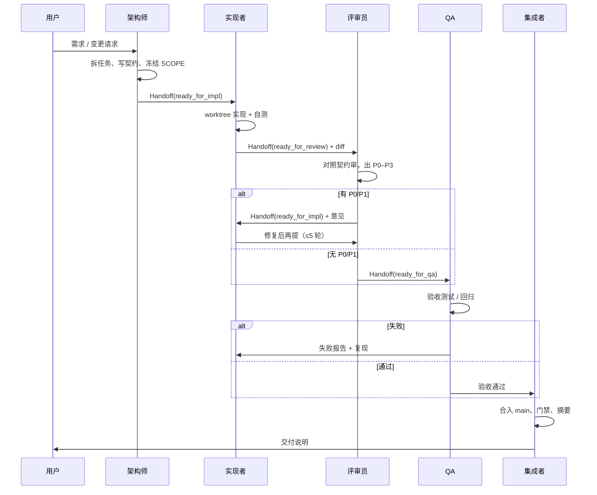

# 多 Agent Pair 开发 — 详细规划

> 目标：多个 agent 扮演不同角色，以「结对 / 协作」方式完成开发；不同角色可用不同模型、不同 agent 工具（MiMo Desktop、Qoder、WorkBuddy、Trae、Claude Code 等）。
>
> 本文是落地蓝图：能力盘点 → 角色与配对 → 工作区隔离 → 通信协议 → 工具/模型绑定 → 实施路线 → 风险。

---

## 0. 一句话定位

把「一个人 + 一个 AI 工具」的开发流，升级成 **「角色化多 Agent 车间」**：

- 有人 **设计**、有人 **写码**、有人 **评审**、有人 **测**、有人 **合入**
- 每个角色挂载 **最合适的模型 + 最合适的工具壳**
- 角色之间用 **结构化交接包** 对话，而不是靠聊天记录猜

---

## 1. 现状能力盘点（你本机已有的底座）

| 能力 | 来源 | 用途 |
|---|---|---|
| 跨会话通信 | MiMo Desktop `session-chat` / `talk_to_session` | 会话即「同事」，可互相请示、讨论、接力 |
| 外部 IDE 派发 | `~/.agents/skills/external-review/` 的 `review_dispatch.py` / `read_review_replies.py` | 把任务发给 Qoder / WorkBuddy / MiMo IDE，读回结果 |
| Trae 派发 | `skills/pair-crew/scripts/send_trae.py`（`trae-cn chat` 子命令） | 不需要 CDP 端口；用 cwd 定位项目，读回靠 `--result-file` 契约文件 |
| CDP 自动化 | 同 skill 的 `cdp.py` | 维护对各 IDE 的 DOM 选择器，保证派发可用 |
| 会话内子代理 | MiMo `actor` (explore / general) | 并行侦察、实现、复审；不占用户可见会话 |
| 外部 CLI Agent | `contacts` 里的 Claude Code 等 | 长任务、独立上下文、headless 交付 |
| 模型/推理档位 | 会话与定时任务可指定 `model` / `reasoning` | 按角色绑定不同模型与推理强度 |
| 记忆 | project / session notes / task progress | 交接包、决策、踩坑沉淀 |
| 工作台任务 | `task` 工具 T1/T2… | 车间里的「工单板」 |

**已知痛点（从历史会话反推）**：

1. **共享工作区并发写会互相踩** → 必须 worktree / 分支隔离（曾出现主工作区被并发 agent 改到编不过）
2. **外部 IDE 是 GUI 壳** → 选择器会因 UI 改版失效，要有健康检查与人工兜底
3. **评审轮次会爆炸**（曾 25 轮）→ 要有 P0–P3 分级、收敛阈值、强制退出条件
4. **上下文不对齐** → 交接必须带「契约文件」而不是只靠聊天

---

## 2. 总体架构



**关键原则**：

1. **角色与工具解耦** —— 「实现者」是角色；今天可以用 Qoder，明天换 WorkBuddy，协议不变
2. **契约先于代码** —— 接口、验收标准、禁止改动范围先写死
3. **单写者原则** —— 一个 worktree / 分支同一时刻只有一个写者
4. **可收敛的评审** —— 有轮次上限与 P 级退出条件

---

## 3. 角色设计

### 3.1 核心角色

| 角色 | 职责 | 输入 | 输出 | 不做什么 |
|---|---|---|---|---|
| **Architect 架构师** | 拆任务、定契约、定技术方案 | 需求 | `contracts/*.md` + 任务拆分 | 不写业务实现 |
| **Implementer 实现者（Driver）** | 按契约写码、跑本地自测 | 任务包 + 契约 | 分支/PR + 自测报告 | 不擅自改契约 |
| **Reviewer 评审员（Navigator）** | 对照契约审代码、找缺陷分级 | diff + 契约 | `review/P{n}-*.md` 意见 | 不直接改实现分支 |
| **QA 验证员** | 端到端/边界/回归验证 | 验收标准 + 构建物 | 通过/失败 + 复现步骤 | 不修产品码 |
| **Integrator 集成者** | 合入、冲突解决、门禁、发版 | 通过的分支 | main 上的提交/发布说明 | 不发明新功能 |

### 3.2 Pair 模式（按任务选型）

| 模式 | 组合 | 适用 | 节奏 |
|---|---|---|---|
| **经典结对 Pair** | Driver 实现 + Navigator 实时跟审 | 中小特性、接口复杂 | 小步提交，每步过目 |
| **搭档开发 Partner** | 一人写实现 + 一人写测试，同 Story 同频 | 大多数功能 Story | 高频对齐（见 §3.3） |
| **双环评审 Double-loop** | 实现 → 评审 → 修复 → 复审 | 中高风险改动 | 轮次上限 3–5 |
| **蜂群 Swarm** | 1 实现 + N 专项评审（安全/性能/可测） | 核心链路、支付、权限 | 并行审，汇总裁决 |
| **设计结对 Design Pair** | 架构 + 测试设计，先契约后实现 | 新模块、跨服务 | 先契约冻结再开工 |
| **接力棒 Relay** | A 产出半成品，B 接手完赛 | 长任务、跨工具优势 | 明确交接包与状态 |

**默认推荐**：多数 Story 走 **搭档开发（Partner）**——最接近真人 pair；核心路径 **蜂群**；探索期 **设计结对**；低风险小修 **双环**。

**派发人数**：默认从可用池**随机抽 2 个**（用户点名工具或数量优先）；蜂群属于扩人模式，须用户点名，agent 不得自行加人。

### 3.3 真人 Pair 对齐（沟通频率是设计目标，不是副作用）

真人 pair 的价值来自 **随时能对齐**，不是「最后交作业」。本流程按三段对齐：



| 阶段 | 频率 | 参与 | 产出 |
|---|---|---|---|
| **① Story 启动** | 每个 Story 一次，强制 | 主持 + 实现 + 测试（+ 必要时设计） | Story Card 共识 + 例子表 `examples.yaml` |
| **② 搭档并写** | 高频：每 15–25 分钟或每完成 1 个例子 | 实现 + 测试 | 实现与测试同步增长 |
| **③ 评审收口** | 低频可批 | 评审 / 集成 | 意见批次 + 合入 |

**对齐通道怎么落（多 Agent 侧）**：

- 启动会：主会话开短「圆桌」——用 `talk_to_session` 等并行确认实现/测试两方对例子表的理解，再冻结契约
- 并写期：**不是**整包交接；按 `examples.yaml` 的例子粒度互相 poke（「例 3 已绿 / 例 4 假设是否 X？」）
- 每个例子完成后写一条状态到 HANDOFF，另一方立刻可见
- 若两方对例子理解冲突 → 立刻升级主持人裁决，**禁止各自硬写**

**搭档分工默认**（接近真人「一个写实现一个写测试」）：

| 角色 | 写什么 | 不写什么 |
|---|---|---|
| 实现者 Driver | 生产代码、最小自测 | 不替对方写完整测试套 |
| 测试者 Partner | 单测 / 契约测 / **UI 布局与流程测** | 不直接改生产码（改测试侧或提 issue 给实现） |
| 评审员 | 只读 + 意见 | 不参与并写（避免既当运动员又当裁判） |

---

## 4. 工作区与并发隔离（成败关键）

### 4.1 布局

```
<repo>/
  main                  ← 唯一集成线
  worktrees/
    impl-<taskid>/      ← 实现者独占写
    review-<taskid>/    ← 评审者只读 + 意见文件（不写业务码）
    qa-<taskid>/        ← QA 独占写（测试/脚本）
  contracts/
    <taskid>/
      SPEC.md           # 需求与验收
      API.md            # 接口契约
      SCOPE.md          # 允许改/禁止改
      HANDOFF.md        # 交接包（状态机）
  .agents/
    BOARD.md            # 全局工单板
    ROUTING.yaml        # 角色→工具/模型 绑定
```

### 4.2 规则

1. **一个 task 一条集成线**，禁止两个 agent 在同一 worktree 同时写业务代码
2. **评审者不改实现分支**；意见写进 `contracts/<id>/review/`，由实现者消化
3. **QA 可写测试与脚手架**，测试通过后由 Integrator 合入
4. **冲突只在 Integrator 的合并阶段解决**，冲突时叫回原实现者
5. 历史教训：不要让多个 agent 直接写主工作区——曾导致编译不过、需 `git archive` 才能独立核验

---

## 5. 通信协议（交接包 Handoff Packet）

所有跨角色消息尽量走 **结构化交接包**，聊天只作通知。

### 5.1 最小 schema（HANDOFF.md / JSON）

```yaml
task_id: T42-支付关闭单
from: architect
to: implementer
status: ready_for_impl   # draft|ready_for_impl|in_impl|ready_for_review|in_review|ready_for_qa|done|blocked
summary: |
  实现 closeOrder 超时关单，含幂等与错误码。
contracts:
  - contracts/T42/SPEC.md
  - contracts/T42/API.md
  - contracts/T42/SCOPE.md
acceptance:
  - 单测覆盖关单成功/已关/订单不存在
  - 不引入新的公共 API
constraints:
  - 禁止改支付 SDK 依赖版本
  - 禁止改无关模块
deliverables:
  - branch: impl/T42-close-order
  - self_test: ./mvnw -Dtest=CloseOrderTest
open_questions: []
priority: P1
```

### 5.2 测试分层（UI 是一等公民）



| # | 类型 | 谁写 | 谁跑 | 关注点 | 过门 |
|---|---|---|---|---|---|
| 1 | **单测** | 测试者为主，实现者补 | 实现者自测 + QA 抽 | 函数/逻辑边界 | 相关绿 |
| 2 | **契约/验收测** | 测试者（对照例子表） | 双方 + QA 复核 | SPEC 例子逐条 | acceptance 全勾 |
| 3 | **集成/接口测** | 测试者 | QA | API/跨模块不破 | 契约稳定 |
| 4 | **UI 布局测 Layout** | 测试者 | QA / 前端 agent | **组件状态、间距/换行/遮挡、响应式断点、空/错/载入态、主题与文案** | 视觉清单通过 |
| 5 | **UI 流程测 Journey** | 测试者 | QA（Playwright 等） | **模拟真点**：登录→主流程→关键按钮/表单/弹窗/返回/刷新/权限拦截 | 关键用户路径可走通 |
| 6 | **端到端/回归** | 测试者 + QA | 集成前 | 混合主链 | 回归不红 |
| 7 | **范围 SCOPE** | 自动脚本 + 评审 | 提审/合入 | 不越禁改区 | diff 合规 |
| 8 | **评审门禁** | 评审（可蜂群） | `in_review` | 正确性/安全/契约 | 无未处理 P0/P1 |

#### UI 测试细则（两类分开做，不要混成一锅）

**4. UI 布局测 Layout —— 「长得对不对」**

- 检查项示例：元素是否溢出/重叠、字号行高、断点（手机/平板/桌面）、暗色模式、长文案截断、空状态/加载/错误态、图标对齐、焦点环
- 手段：组件级快照 / 视觉对比（截图 diff）/ 布局断言（bounding box）/ 人工对照清单
- 产出：`ui/layout-checklist.md` + 截图目录 `ui/shots/`
- 典型判定：给定视口 × 状态 × 文案长度 → 无遮挡、关键操作可见

**5. UI 流程测 Journey —— 「走不走得通」**

- 模拟 **真实用户点击路径**：打开页 → 点 CTA → 填表 → 提交 → 断言 toast/跳转/数据 → 返回/刷新仍正确 → 无权限/失败分支
- 手段：Playwright（优先）/ 其他 E2E；选择器要稳定（`data-testid`）
- 产出：`ui/journeys/*.spec.ts`，每条 Story 至少 1 条主路径 + 1 条失败路径
- 典型判定：Journey 全绿才算 UI Story 验收；只有截图好看不算过

**在流程中的位置**：

| 阶段 | UI 测动作 |
|---|---|
| Story 启动 | 例子表里写明 **关键用户路径** 与 **布局风险点**（要测什么先说清） |
| 搭档并写 | 测试者同步写 Layout 清单 + Journey 草稿；实现者每完成一屏/一步即跑一条 |
| QA 验收 | 全量 Layout 检查 + 主 Journey + 1 条异常 Journey |
| 合入前 | Journey 作回归门禁（主路径） |

### 5.3 评审意见分级（强制收敛）

| 级别 | 含义 | 处理 |
|---|---|---|
| **P0** | 正确性/安全/数据损坏 | 必须修，阻断合入 |
| **P1** | 契约违反、明显缺陷 | 必须修，可一轮集中 |
| **P2** | 质量/可维护 | 建议修，可记债 |
| **P3** | 风格/命名 | 可选 |

**退出条件**：连续 2 轮无新增 P0/P1 → 进入 QA；评审轮次 **硬上限 5**（超了升级人工裁决）。

### 5.4 状态机



---

## 6. 工具与模型绑定矩阵

> 原则：**角色决定职责，模型决定火力，工具决定壳**。三者可独立换。

### 6.1 推荐绑定（可按项目改 `ROUTING.yaml`）

| 角色 | 优先工具 | 备选 | 模型倾向 | 推理档 | 备注 |
|---|---|---|---|---|---|
| Architect | MiMo Desktop 主会话 | Claude Code | 强推理/长上下文 | high–xhigh | 要看全局 |
| Implementer | Qoder 或 WorkBuddy | Trae（CLI chat）/ MiMo actor(general) | 强代码模型 | medium–high | 按仓库语言选擅长者 |
| Reviewer | 独立 MiMo 会话 / WorkBuddy | Qoder / Trae | 批判性强、爱挑刺的模型 | high | **换模型**做对抗审 |
| QA | MiMo actor + 脚本 | WorkBuddy | 稳、服从指令 | medium | 重执行 |
| Integrator | MiMo 主会话 | Claude Code | 稳、谨慎 | high | 只合入不创新 |
| 侦察/检索 | MiMo actor(explore) | — | 快 | low–medium | 只读 |

### 6.2 异构模型策略（有意为之）

- **实现与评审不要同模型**，降低「同源盲区」
- **架构用最贵推理**，实现用性价比，QA 用稳定服从
- **能力门禁**：UI 布局/视觉类测试必须绑 **多模态（能看图）** 模型；纯文本模型只写 Journey 脚本、跑 DOM 断言，**不做截图目检**
- 排队/限流时：WorkBuddy 侧脚本已支持切空闲模型；MiMo 侧可降档或延后

### 6.3 模型 / 上下文 / 思考强度怎么指定（按运行时）

> 三层分离：**能力声明**（能不能看图、窗口多大）→ **路由选择**（ROUTING.yaml）→ **调用时注入**（谁在何时传什么参数）。

| 运行时 | 指定模型 | 指定思考强度 | 控制上下文 | 多模态 |
|---|---|---|---|---|
| **MiMo actor 子代理** | `actor.spawn` 的 `model`：模型组名（`ultra/standard/lite`）或字面 `provider/model` | 用该模型/档位支持的 reasoning；工作流配置里可带 | 子代理自带窗口；prompt 只塞契约/任务包，大块资料走文件 | 选 `modalities` 含 image 的模型 |
| **MiMo 定时任务** | `automation_update.model`（精确 model ID）+ `modelName` | `reasoning`: `low/medium/high/xhigh/max` | prompt 内嵌；上下文靠任务会话 | 同上 |
| **MiMo 会话（session-chat）** | 会话级模型在 **创建/界面** 选；Skill 只在 prompt 里写明「请用 X 模型」或让用户/主持预置 | 桌面设置/模型自带档；Skill 在 prompt 要求「加强推理」不等于改 API 档 | 会话历史 + 注入的契约路径 | 看会话所用模型 |
| **WorkBuddy** | 脚本点 UI 模型选择器（`_wb_pick_model`）；有排队自动切 `WB_FALLBACK_MODELS` | IDE 内设定，Skill **不能**可靠改思考档 | prompt 全文塞进输入框 | 看 IDE 当前模型是否多模态 |
| **Qoder** | 主要靠 IDE 当前模型；派发脚本基本不换模型 | 同上 | prompt 全文 | 同上 |
| **Claude Code** | 会话/CLI 配置 | 会话配置 | prompt + 工作区文件 | 选支持视觉的型号 |

**Skill 派发时实际注入的是什么（「上下文」）**：

1. **不塞整仓**——只塞：HANDOFF + 契约路径 + 例子表 + 禁改 SCOPE + 验收清单  
2. **大体积证据走文件路径**：截图、日志、diff 路径写在 prompt 里，让对方自己读  
3. **窗口不够时**：靠 `compaction.max_context` / 分段交接，而不是把历史聊天全塞进去  

**ROUTING 能力声明（多模态一等公民）**：

```yaml
model_groups:
  vision: "provider/multimodal-model"    # 能看截图
  code:  "provider/code-model"
  critic: "provider/other-model"

roles:
  ui_layout_tester:
    runtime: actor
    model: vision          # 必填能力：vision
    requires: [vision, image_read]
    reasoning: medium
    context_style: files   # 只给路径+清单，不粘贴大图 base64
  ui_journey_author:
    runtime: external-ide
    tool: workbuddy
    model: code            # 可不看图：写 Playwright、跑 DOM 断言
    requires: [browser_auto]
  implementer:
    runtime: external-ide
    tool: qoder
    model: code
    reasoning: high
```

**路由检查（`routing_check.py`）在开工前校验**：

1. 角色声明的 `requires` 是否被模型 `modalities` 覆盖（无 vision → 禁止排到 UI 布局目检）  
2. 外部 IDE 当前模型是否可读/可切  
3. 思考档是否在模型支持集内（不支持 `xhigh` 就降档并记录）

**边界说明（避免误以为 Skill 万能）**：

- MiMo 侧：`model` 可在 actor/定时任务参数里传；**推理档**在部分入口可传（如任务的 `reasoning`），并非所有调用点都暴露  
- 外部 IDE：模型/思考档是 **UI 状态**，Skill 只能「切一下/提示用户」，不能像 API 一样稳定强制  
- 因此 ROUTING 写的是 **意图绑定**；`routing_check` 负责 **证实或降级**，打不到就换角色载体或报人工

### 6.4 `ROUTING.yaml` 草案

```yaml
# 能力层：模型组 + 模态（是否能看图）
model_groups:
  vision: "<多模态模型 provider/model>"
  code:   "<代码模型>"
  critic: "<与 code 不同的评审模型>"

roles:
  architect:
    runtime: mimo-session
    session_name: "架构师 · 主规划"
    model: <强推理模型>
    reasoning: xhigh
  implementer:
    runtime: external-ide
    tool: qoder          # qoder | workbuddy | mimo-ide | claude-code
    model: code
    reasoning: high
  reviewer:
    runtime: mimo-session
    session_name: "评审员 · 对抗审"
    model: critic
    reasoning: high
  ui_layout_tester:
    runtime: actor
    subagent_type: general
    model: vision
    requires: [vision, image_read]   # 无多模态不得排此岗
    reasoning: medium
    context_style: files
  qa:
    runtime: actor
    subagent_type: general
    model: code
    reasoning: medium
  integrator:
    runtime: mimo-main
    model: code
    reasoning: high
```

---

## 7. 端到端工作流（以一个需求为例）



> 上图为「低频收口」示意。若采用 **搭档开发（Partner）**，① 启动对齐和 ② 并写期是高频的（见 §3.3），只有 ③ 评审/QA/合入按批次走。UI 布局测与 UI 流程测在 ② 同步编写，在 QA 阶段全量执行。

### 7.1 人工介入点（必须保留）

1. 契约冻结前的 **需求确认**
2. 评审 **轮次超限** 或双模型结论对立
3. 合入 main / 对外可见的 **高风险动作**
4. 外部 IDE **派发失败**（工作空间选不到、任务占用、选择器失效）

---

## 8. 落地形态（建议做成 1 个 Skill + 1 套约定）

在 `coding_skill` 仓库里落成：

```
coding_skill/
  docs/
    multi-agent-pair-plan.md      # 本文
  skills/
    pair-crew/
      SKILL.md                    # 触发词：pair 开发 / 多 agent 结对 / 车间模式
      prompts/
        architect.md
        implementer.md
        reviewer.md
        qa.md
        integrator.md
      scripts/
        handoff.py                # 读写 HANDOFF / 状态迁移
        board.py                  # 工单板
        worktree.sh               # 创建/回收 worktree
        routing_check.py          # 校验各 runtime 是否在线
      templates/
        HANDOFF.md
        ROUTING.yaml
        contracts/
```

**触发方式**：`/pair-crew` 或「用结对模式 / pair-crew 做 XX」。Skill 名 **pair-crew**（结对班组）。

**Skill 主流程**：

1. 读 `ROUTING.yaml` → 做 **runtime 健康检查**（Qoder/WorkBuddy 窗口是否在、是否空闲）
2. 建契约目录 + 工单
3. 建 worktree
4. 按状态机派发/读回（复用 `external-review` 的 dispatch/read）
5. 收敛后集成，归档交接包

---

## 9. 分阶段实施路线

### Phase 0 — 协议与约定（0.5–1 天）
- 写死 Handoff schema、评审 P 级、状态机
- 定 `ROUTING.yaml`、目录约定、单写者规则
- **产出**：`docs/` 下契约模板 3 份

### Phase 1 — 最小可用双环（1–2 天）
- 只做 **Implementer + Reviewer** 两角色
- 用 **同一条链路**：MiMo 主会话派发 → Qoder 实现 → WorkBuddy/MiMo 评审（或 actor 评审）
- 手工跑通 1 个真实小需求
- **产出**：`pair-crew` skill 雏形 + 1 条成功样例

### Phase 2 — 工作区隔离与工单板（1–2 天）
- worktree 脚本、BOARD、状态迁移脚本
- 把「共享工作区互踩」彻底堵死
- **产出**：可并行 2 个 task 不互扰

### Phase 3 — 全角色 + 外部 IDE 稳定派发（2–3 天）
- 加入 Architect / QA / Integrator
- 打磨 `review_dispatch` 在 WorkBuddy/Qoder 的选择器与失败兜底
- 健康检查与「请人工点一下」的降级路径
- **产出**：五角色车间，能跑完整双环

### Phase 4 — 异构模型与蜂群（持续）
- 实现/评审强制异构模型
- 核心路径开 Swarm（安全/性能/可测三审）
- 用记忆沉淀「哪类任务用哪组绑定效果好」
- **产出**：绑定矩阵的经验版

### Phase 5 — 质量度量（可选）
- 统计：评审轮次、P0 密度、返工率、端到端时长
- 反哺路由（某工具在某语言上返工高就换）

---

## 10. 风险与对策

| 风险 | 表现 | 对策 |
|---|---|---|
| 并发写共享区 | 编不过、互相覆盖 | worktree + 单写者 + 合入只在 Integrator |
| 评审发散 | 20+ 轮还停不下来 | P 级退出、硬上限 5、无新 P0/P1 即走 |
| 外部 IDE 派发失败 | 按钮找不到、工作区选不到 | 健康检查、DB 登记路径、人工一次性授权、选择器可修 |
| 上下文漂移 | 产出跑题、改超范围 | SCOPE.md 禁改清单、diff 范围检查 |
| 同模型同源盲区 | 实现与评审一起错 | 强制实现/评审异构模型 |
| 通知过载 | 刷屏 | 交接包文件为准，聊天只发状态变更 |
| 高风险误合入 | 改坏 main | 合入前门禁 + 人工确认 |
| 工具 UI 改版 | 自动化整体失效 | dispatch 与协议层解耦；可退回 session-chat / actor |

---

## 11. 成功标准（可验收）

1. **一个真实需求** 在 Partner 模式下走完：启动对齐 → 并写（实现+测试）→ 评审 → QA → 合入
2. **启动会产出例子表**，实现/测试双方对关键例子无分歧
3. **UI 布局检查清单 + 至少 1 条主路径 Journey + 1 条异常 Journey** 全绿才算 UI Story 过
4. **两个 task 并行** 不互相踩工作区
5. **实现与评审使用不同模型/工具** 仍能闭环
6. 评审轮次 **≤5** 且能按 P 级收敛
7. 外部工具挂掉时，能 **降级到 MiMo 会话/actor** 继续，而不是卡死

---

## 12. 下一步（建议你拍板的 3 件事）

1. **首个试点需求**：选一个 0.5–2 天能做完的真实小需求（别一上来支付核心）
2. **工具分工偏好**：实现更想用 Qoder 还是 WorkBuddy？评审固定给谁？
3. **模型绑定**：本机哪些模型可用、哪些愿意给评审员用（决定 ROUTING 落地）

拍板后从 **Phase 0 + Phase 1** 开干，先跑通最小双环，再扩车间。
